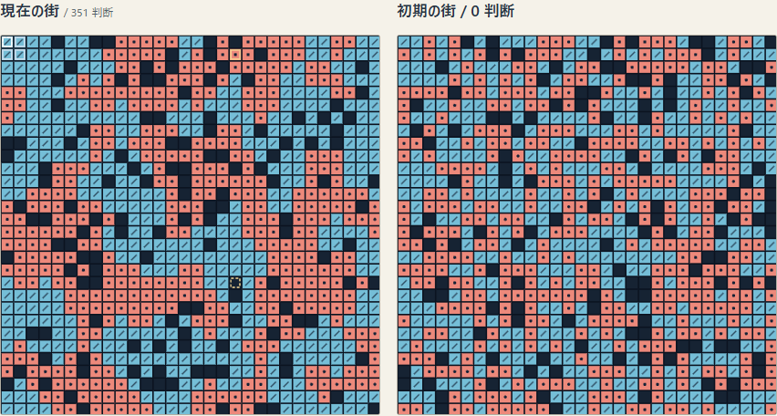
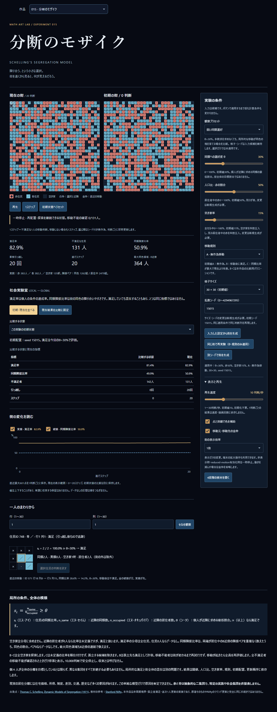

# 「分断のモザイク」自己検証

総合判定：**PARTIAL**。数学・ローカル自動検証の結果を記録し、独立レビューを依頼する。実機と支援技術の未検証を成功扱いしない。マージ推奨は現時点 **NO**。独立レビュー待ちで停止し、Draft解除・merge・auto-merge・公開は行わない。

## 対象と環境

- 開始main：`dd66a7fe822607dee422d16d9d1035c38dac19df`（GitHub API、`git ls-remote`と照合）。作業ブランチ：`feat/015-segregation-mosaic`。
- 製品ソースのcommit：`67f54bc`。以降の提出用commitは記録・試験ログ・画像のみとし、最終HEADはDraft PRの提出コメントで固定する。
- 依頼全文：[Issue #39](https://github.com/tetsujisugimori-coder/Math-Art-Lab/issues/39)。本文を変更せず、[原本](request.md)と[読戻し](issue-readback.txt)の全文一致を監査スクリプトで確認。
- Windows 11（OS報告10.0.26300）、Intel Core i7-14650HX、論理CPU24、Node v24.20.0。npm lockに従った既存依存。新依存なし。
- Playwright 1.58.2のChromium／WebKit。デスクトップWindows上のブラウザエンジンであり、実機Safariの代替とは扱わない。
- Chromiumは既存設定の`--use-angle=swiftshader --enable-unsafe-swiftshader`を使用。ソフトウェア描画の検証環境であり、実機GPUの性能値ではない。
- 開発：Vite、既存 `playwright.config.ts`。本番：`npm run build`後、既存 `playwright.production.config.ts`で `/Math-Art-Lab/` のbaseパスから実行。
- Git管理領域とesbuildの親ディレクトリ参照にサンドボックス拡張が必要だった。通常権限での初期ビルド／試験起動失敗は検証成功に数えず、許可済み実行のログを保存。

## 数学と計算

全単体 **317成功（29ファイル）**。既存289件に本作品28件を追加。[全文ログ](unit-results.txt)。[型検査](typecheck-results.txt)と[本番ビルド](build-results.txt)も成功。

| 観点 | 証拠 |
| --- | --- |
| 境界 | 角3・辺5・中央8セル、反対辺へつながらない |
| 比率 | 空き家除外、同類／異類、0人の未定義、θ=0／100、60%の等号 |
| 初期人数 | 空き家を先に四捨五入、残人口から赤を四捨五入、青は差分。空き家0／100、赤0／100、seed0、無効値 |
| 行き先 | 移動元を空ける既知配置、A/B/Cの相違、Bの孤立満足、Cの未定義除外・厳密改善・最大値・同率 |
| 独立基準 | 144条件（12seed×4閾値×3規則）で行き先を実際に組み直した格子の直接全セル計数と一致 |
| 保存 | 各規則200判断、全ID集合・重複なし・色・人数・空き家数を保存 |
| 再現 | seed0の再実験、別seedの相違、100判断を一括／分割し、その間の統計・表示変換の回数を変えて全状態一致 |
| 停止 | 住民0、満足、空き家なし、全不満足者を調べるまで停滞にしない、10,000到達後の不変 |
| 指標 | ペア非重複・分母0・8近傍連結、別の直接全ペア走査と一致 |
| グラフ | 実際のステップ座標、%軸、未定義で線を分断、履歴601点の上限と現在値一致 |

初回の2失敗はテスト配置の手計算誤り（候補セルの同類は1/5、また青も改善できる配置だった）を校正したもの。製品不具合のREDとして扱わない。

## RED → GREEN

自己点検で次の実不具合を発見し、製品修正前に両ブラウザで再現した。

1. 既定表示中の住民の情報は出るが、選択IDがnullのため本人の判断ボタンが何もしない。seed1・θ=100で「1判断になるべきところ0」のRED。表示と追跡IDを同期して修正。
2. 教材の中でグラフ系列を切り替えると、終了後もその表示が残った。教材開始前の個別表示設定も保存・復元して修正。

[修正前4失敗](evidence/red-regressions.txt)、[失敗画像とコンテキスト](evidence/red-results)、[同条件の修正後4成功](evidence/green-regressions.txt)を保持。修正前は初回コミット前のローカル実装であり、存在しないGitのRED revisionを記載しない。回帰は開発・本番の通常試験へ追加した。

3. 画像点検でWebKitのnative selectがCSS背景を無視し、白地に白文字となることを検出。共有作品pickerでは実画素背景244/244/244、文字229/239/255、コントラスト比約1.054。ライト・ダーク各1失敗を[REDログ](evidence/native-red.txt)と[失敗画像](evidence/native-red-results)へ保存。既存Cobwebと同じappearance抑制＋CSS矢印を新作品に限定して採用。修正後は共有picker／プリセット／方式／サイズ／倍率／比較状態の6欄を両テーマ・両エンジンで検査し、4.5以上を確認した。

矢印の背景指定が入力共通の`:is()`より低い優先順位にならないよう`select[id]`へ調整し、背景画像が消えていないことも同じ回帰に追加。背景対策のみの開発42件／本番42件の成功ログは`e2e-*-native-background-pass.txt`へ保持し、最終スタイルの再実行と区別する。

## ブラウザの検証範囲

修正後の開発 **42/42成功（3.7分）**：[ログ](e2e-development-final.txt)。最終本番 **42/42成功（3.3分）**：[ログ](e2e-production-final.txt)。初回32/32の成功も[別ログ](e2e-development-first.txt)として保持。native select問題の検出前の開発38/38・本番38/38も[開発履歴](e2e-development-before-native-fix.txt)／[本番履歴](e2e-production-before-native-fix.txt)へ分離した。操作試験の成功を実画素コントラストの成功と混同しない。

21:02 JSTの再開時、最終本番試験のセッションが失われ、ログは24件目で止まっていた。終了コードも取得できず、成功・製品失敗のどちらとも判定しない。[中断ログ](e2e-production-interrupted.txt)を保持して全42件を再実行した。原因を断定しない。

- 再生／一時停止／1判断／リセット、速度変更、同一seedの再現と別seed。
- 全6プリセットを選択しても街が変わらず、明示的適用でのみ生成。各規則、人口・空き家・サイズ・seed、入力不備の拒否。
- θ・規則だけを変える同じ街の実験、比較結果の固定、初期／固定結果切替、現在と比較図の確定ステップ。
- **Canvasの実画素からセルの色を読み取り、別の全近隣計数で満足率・隣接比率を計算してDOM値と一致**。グラフ現在値・線の端点、個別非表示を確認。
- 住民IDの追跡、選択本人の移動、近隣3×3図、移動元／先の説明。
- 教材の全4段階、前後移動、操作制限、正誤フィードバック、Escape・フォーカス・街と候補入力と系列表示の復帰。
- 矢印キー、行・列の代替操作、2倍の街の表示、reduced-motionの有効化による停止、表示補助によるステップ数の不変。
- 375／390／765／1280px × light／dark × 両エンジン。文字200%でもdocumentの横溢れなし。比較図、フォーカス、pageerrorなし。
- 作品切替を3回繰り返し、古いタイマーの更新が新しい街へ混入しない。
- 最大40×40・C・θ=80%で操作・再生の実測。seed15015・弱い選好が351判断で満足率100%・隣接比率74.7%になるUI再現。

外部APIやDBは使わない。検証経路は「UI入力 → 純粋な数理更新 → HTML/SVG/Canvas」。サーバ側は静的アセットの配信のみ。

## 性能と再現実験

[監査コード](audit.mjs)／[生データ](evidence/model-audit.json)。16・30・40の3サイズ×3規則×空き家2／15／50%の27条件、各最大120判断。純粋なモデルの1判断最大 **0.6844ms**。これは今回のPCでの標本で、端末一般の性能保証ではない。

初期化と分離の比較は30×30・赤50%・空き家15%・方式A。θ=0%は4seedとも初期で全員満足し、移動しない。θ=30%は次の観測値になった。

| seed | 判断／移動 | 初期隣接比率 | 最終隣接比率 | 最終状態 |
| --- | --- | --- | --- | --- |
| 15015 | 351 | 49.9% | 74.7% | 全員満足 |
| 1 | 334 | 49.2% | 72.7% | 全員満足 |
| 42 | 320 | 47.9% | 73.4% | 全員満足 |
| 2026 | 270 | 51.8% | 74.7% | 全員満足 |

自動クリックの経過時間にはPlaywrightの待機・OS・描画が含まれるため、純粋なモデルCPU時間と比較しない。選択ID・系列復帰の修正後、native select修正前の開発40×40/C/80%の12操作は、ハンドラー内の計算＋DOM＋Canvas命令でChromium3.2〜198.8ms、WebKit4〜8ms。1秒程度の再生で10／24判断を観測。[この時点の値](evidence/browser-performance-before-native-fix-chromium.json)も保持する。Chromiumの長い1標本の原因は特定していない。設定30判断/秒はタイマー目標であり実測保証ではなく、負荷時は進行が遅くなる。結果の判断列を飛ばさない。

初回の値（Chromiumクリック中央値56ms、WebKit257ms）も消去せず保存。最終開発・本番の[ブラウザ別生データ](evidence)と区別する。格子は安全側の16／30／40、速度は1〜30へ制限。大規模な一斉更新や全履歴の無制限保存は提供しない。

最終スタイルでのハンドラー時間は、開発Chromium2.5〜14.1ms／WebKit3〜30ms、本番Chromium2.4〜5ms／WebKit7〜21ms。1秒程度の進行判断数は開発7／22、本番8／21だった。目標30判断/秒に届かない観測値をそのまま残し、なめらかさを全端末で保証しない。

ビルドはJS860.56KB（gzip256.15KB）、CSS58.45KB（gzip11.52KB）。既存の単一バンドルに追加したため500KB警告が継続。警告を隠していない。

## 作品画像

以下は修正後のソースに対応する開発画像。本番画像は `screenshots/production/` に分離。最初の実装の画像は直下に残し、修正後の証拠として再利用しない。

[375px・ライト](screenshots/development/chromium-375-light.png)、[390px・ダーク](screenshots/development/webkit-390-dark.png)、[765px・ライト](screenshots/development/webkit-765-light.png)。主図の格子・模様、比較、空き家、文字の欠けがないことを画像で自己点検。native select、文字拡大、キーボードは自動試験と併用。

`node docs/segregation/capture-evidence.mjs`で[ソース・ビルド・画像・ログのSHA-256一覧](evidence/manifest.json)を作成。LFに正規化した製品ソースhashは`8be13593df444b322173f59871c8b25b6ee2be7b3de4a0adf2e354f1749ecd60`。UTF-16LEログがあれば文字・改行・端末制御列を変更せずUTF-8へ変換して前後のhashを記録するが、今回は変換対象0件。`screenshots/development/`と`production/`が最終ソースの画像で、直下の初回画像やRED画像は最終ソースの証拠に割り当てない。

このディレクトリの`.gitattributes`で画像・JSON・ログの改行変換を抑制する。`node docs/segregation/verify-evidence.mjs HEAD`で、作業ファイルではなくGitの保存内容を読み、73証拠と5ソースのhashを再検証できる（引数省略はindex）。

## CIと提出時の限界

既存GitHub ActionsはPRで単体→型→build→開発全作品回帰→本番全作品回帰を実行する。Pages公開はmainへのpush等に限定されていることを確認し、workflowは変更しない。ローカルでは新作品の両ブラウザを検証し、全作品のE2EはPRの標準CIで照合する。**CIが完了するまでは成功扱いしない。最終HEAD・run・状態はDraft PR本文／コメントへ記録する。**

未検証／残存事項：実機iPhone Safari・Android、実タッチ、スクリーンリーダー、OSレベルの文字拡大、低性能端末・熱／電池影響、長時間の実UIでの10,000判断到達、実タブ非表示の端末別挙動。10,000到達は単体で検証したものと区別する。スナップショットと履歴はメモリ内のみ。全条件で30判断/秒や弱い選好による分離を保証しない。

独立レビュー対象：数理・境界・原著と仮定の区別、B/Cの移動元除外、未定義比率、停止の証明条件、再現性と手動介入、人口／ID保存、比較の公平性、Canvas画素と統計、教材復帰、アクセシビリティ、最終HEADのCI。自己検証を独立レビューとして数えない。
