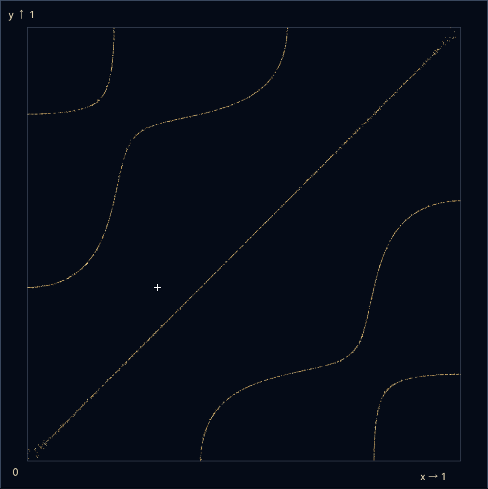
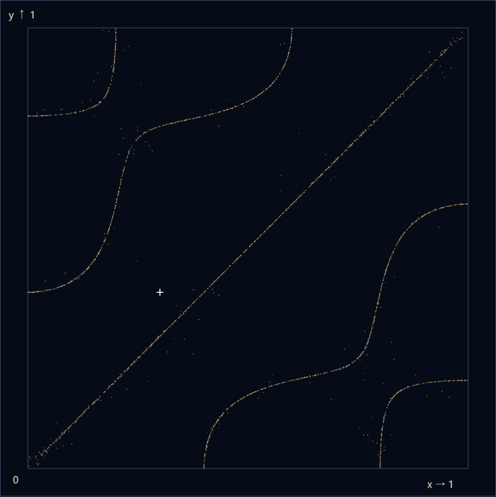

# 012 · 振動の砂絵

2026-11-05追補：[PR #34 P2-01：数式・説明・節の対象の修正](review-34/README.md)。以下は初回提出の履歴として保持する。表示対象と強調対象、教材の記号制限、凡例・描画・キャッシュの現在の契約は追補を優先する。

暗い正方形で砂が動かない場所へ集まる過程と、定在波の形・瞬間の変位を比較する作品。要求原本は[Issue #33](https://github.com/tetsujisugimori-coder/Math-Art-Lab/issues/33)と[request.md](request.md)。Issue本文は変更せず、具体化・失敗・制約を本記録とDraft PRへ残す。

## 着手確認・範囲

開始時はdetached HEAD `7dac29abd51902e302edc2ea52a1d669906e1674`、未コミット変更なし。fetchしたorigin/mainは`503c03ccdb3854eb1d83722df3229daa84876546`。第11作はPR #32で2026-11-03 22:56:51 UTCにMERGED、上記SHAとmergeCommit一致を確認し、そのmainから`feat/012-vibrating-sand`を作成した。ローカルmainは変更しない。

リポジトリ内にAGENTS.mdはなく、上位`C:/Users/tetsu/.codex/AGENTS.md`と会話の「回答の最後に日時」を適用。README、LOG、第11作の教材・描画・サイズ復帰・記号選択、開発／本番GUI、Pages workflowを確認した。GitHub connectorは利用不可を返したためghへ切り替えた。Issueの同一タイトル検索は0件、#33作成後、本文をUTF-8ファイルと改行形式・末尾改行を正規化して読戻し比較し一致。Issue #30など既存残件は変更しない。新規依存なし、既存11作品のソースは変更しない（共通mainへの012登録のみ）。

## 数学モデルと根拠

領域Ω=[0,1]²、右へx、上へy。第一成分C₁=cos(mπx)cos(nπy)、第二成分C₂=cos(nπx)cos(mπy)、F=C₁−aC₂、u=A F cos(ωt)。A=1、ω=1の正規化した位相時間を使用する。観察速度は時間の送り倍率であり、m,nやFを変更しない。異なる模様を同じ物理周波数で加振しているという意味ではない。

採用するのは**Neumann境界条件∂F/∂ν=0**の正方形Laplace固有関数モデル。各辺でsin(kπ·0)=sin(kπ·1)=0なので法線微分が0。−ΔCᵢ=λCᵢ、λ=π²(m²+n²)。m,nを入れ替えてもλは同じで、その線形結合も同じ固有値を持つ。通常の波動方程式w_ττ=c²Δwではω_phys=c√λ、ここではt=ω_phys τと正規化して観察する。自由端の金属板の曲げ振動式・支持点・実物の加振周波数は再現しない。出発案のFを変更していない。

一次／大学資料（2026-11-04参照）：

- [UCSB Math 124B §5.6例題](https://web.math.ucsb.edu/~helena/teaching/math124b/example_5_6.pdf)：Neumann条件に対するcos(nx)固有関数の採用。資料の区間(0,π)から単位区間へ座標を変換し、二方向の積とする部分は本実装の導出。資料の非斉次境界値そのものを本作へ流用しない。
- [University of Toronto / Victor Ivrii, §13.3](https://www.math.toronto.edu/ivrii/PDE-textbook/Chapter13/S13.3.html)：固有関数の0集合としての節、正方形の重複固有値の組合せ、実際のChladni板は自由境界の双調和作用素に対応するという区別。本文の図はDirichletのsin型であり、本作のcos型と同一視しない。
- [Stanford Mathematics: Chladni figures](https://mathematics.stanford.edu/events/student-analysis/chladni-figures-sand-vibrating-metal-plate)：金属板の共鳴と自由境界の双調和作用素という位置付けを照合。

定在波は形を保ち、各場所が周期的に上下する波。節はF=0なので全時刻でu=0。F≠0の場所もcos(t)=0の瞬間だけu=0となる。UIの「一瞬の全面0」はt=π/2を設定し、**Fから計算した節はそのまま**表示する。binary64のcos(π/2)は約6.12×10⁻¹⁷であり、厳密な0とは表示しない。

m,nは1〜8の異なる整数、aは0〜2。m=nを全面的に拒否し、a=1で恒等的0になる退化を防ぐ。これは製品範囲であり数学的限界ではない。m,nが異なる正整数なら余弦直交性により∫ΩF²=(1+a²)/4>0で、全面0ではない。

## 砂の人工的な移動

`sand.ts`の純粋モデルと`State`をDOMから分離。粒子3000個、位置はFloat64Array、速度や衝突は持たない。scatterは単位正方形に一様乱数で配置する。seedは1〜2³²−1、初期12012。xorshift32（左13・右17・左5、uint32/2³²）。各stepで各粒子に必ず2乱数を消費し、止まった粒子も消費順を変えない。

位置q、f=F(q)、g=∇F(q)について、第一候補は `q−L f g/(|g|²+10⁻¹²)`、`L=min(1,0.012/|f g/(|g|²+10⁻¹²)|)`。F²を下げるための正規化した投影的候補で、最長移動0.012。第二候補は乱数角θと半径r=0.004+0.024Rの `q+r(cosθ,sinθ)`。両候補を境界で反射し、F²が小さい方を選び、それが元より厳密に小さい場合だけ採用する。反射はvを周期2に折り返し、[0,1]へ戻す。wrapで反対辺へ飛ばさない。

|F|/(1+a)≤0.009ならその粒子を保持。この幅は**表示上の節付近判定**で、数学的な節の認定ではない。F²の勾配のみでは節でない停留点に止まるため、乱数候補を入れた。角(0,1)、m=1,n=2,a=1の非節停留点から脱出する試験を含む。乱数候補は物理的な揺れの計算ではない。受理条件がF²減少なので局所的な停滞が残る可能性はあり、全節への均一性・完全収束は保証しない。

砂は固定の整数step。名目時間刻みΔ=1/30相当の離散可視化であり、連続物理運動のEuler積分ではない。1コールバック1step、遅れの追いつき計算なし。再生は50ms後に次の1stepを予約、最大600stepで停止。振動は別時計でt←t+(1/30)×観察速度。再生と手動送りは同じ`tick`／`advance`を使用し、描画やDPRは乱数を消費しない。JavaScriptエンジンをまたぐMath.cos等の最下位bit一致は保証しないが、同じ実行環境の同設定・seed・stepでは粒子配列が一致する。

初期「完成形」は節へ直接配置したものではなく、seed12012の一様配置から**320stepの有限結果**。再読み込み・リセットでも同じ結果を計算。4プリセット（交差のひろがり1/3/1、丸みの区画2/3/1、細かな織り4/7/1、ゆらぐ格子2/5/0.55）は実計算の比較で選定した印象名。seed1,42,12012,987654321を各プリセットで検証し、特定seedだけで成功としない。

## 描画・操作契約

表示Canvasは1枚、144²画素の非表示raster用Canvasは最大1枚。大量の砂と符号分布にCanvas2Dを用い、ラベル・フォーム・読み上げの値はHTMLへ持つ。色の役割は暗い背景、砂の金、分布の正=金／負=青、観察点の白十字、節の白破線、強調の横実線／縦破線／輪／内枠。色の意味は常時ラベルで明記する。WebGLやSVGの数千DOM要素を追加しない。

Canvas内は左右上下5.5%の余白、描画域89%。`X=.055+.89x`, `Y=.945−.89y`で、ポインターは枠線を除いた内容領域で逆変換。DPR最大2、各辺1000pxまで。主RGBAバッファ最大4,000,000 bytes（約3.81MiB）、補助rasterと作成時ImageDataは各82,944 bytes（ブラウザ全体メモリの保証ではない）。分布144²標本をImageDataへ入れ、拡大描画時に補間する。Fと成分は設定／表示が同じなら再利用し、uだけ位相で更新する。節は128²格子を2三角形ずつに分割し、辺の符号反転を線形補間する。節のPath2Dは正規化座標でキャッシュし、位相・画面サイズに依存させない。砂は3色のpathへまとめる。全キャッシュはCanvasに結びつけ、破棄時は削除し両バッファも0サイズへ解放する。

節の線は有限画素・補間・線幅による近似であり、厳密なF=0の集合そのものではない。砂、観察値、節は適用済みStateを共有する。u表示でtが変わっても節をuの0から作り直さない。因子／各成分表示ではその対象の節を描く。横因子表示では色が静的因子、白曲線がcos(mπx)cos(t)の断面（基準高さ0.5、上下尺度0.3）、金の丸が常に0の位置。曲線は正方形の実際の変形ではなく、1次元の上下を示す模式表示と明記する。

|操作|砂|振動・その他|
|---|---|---|
|初期・初期設定へ戻す|seed12012、320step|m=2,n=3,a=1、t=0、停止、砂表示、節OFF、観察点(.3,.4)、強調解除|
|設定を適用・プリセット|指定seedを一様配置、0step、停止|t=0、時間送り回数0、停止。表示・観察点・強調は保持|
|入力中・不正入力|直前の有効状態を保持|候補はフォーム内、適用値は別表示。エラーを説明|
|砂を散らす|現在seedで0step、砂だけ停止|t・振動再生は保持|
|砂を再生／停止／1step|砂のみ操作|位相は保持。両方の再生を同時に選ぶことも可能|
|振動を再生／停止／1step|保持|時刻だけ操作。1stepは速度×1/30|
|観察速度変更|保持|速度を変更、振動のみ停止。時刻を保持|
|時刻を0へ／全面0を見る|保持|振動のみ停止。後者はt=π/2、u表示、Fの節ON|
|表示・記号・観察点|保持・乱数消費なし|時刻と再生状態も保持|
|教材の段階切替|状態保持、両方停止|段階の表示を選び、1は横因子、2は横・縦・積のみ、3は比較、4は砂と節|
|教材終了・Escape|開始前の配列・seed・rng・stepをdeep copyから復元|設定・時刻・速度・観察点・表示・強調・再生も復元。安全停止があれば停止を優先|
|タブ非表示・reduced-motion有効化|保持・停止|両方停止、非表示中の予約を取消。復帰しても自動再開しない|
|作品切替・pagehide|破棄|AbortController、ResizeObserver、描画rAF、再生／サイズ待ちtimerを解放|

教材1〜3はプリセット・設定適用を無効化して前提を維持する。4では変更可能で、説明の現在模様名は適用値から生成。全面0とFの節の比較ボタンは第3段階から利用し、最初の2段階で突然Fの全体図へ飛ばない。教材開始前をstructuredCloneで保存する。教材復元はUIの未適用候補を適用済み値へ戻す（未適用フォーム文字列は復元対象外）。

図はクリック・タップ、矢印0.01／Shift0.05、座標フォームで選択できる。pan-yでページのスクロールを妨げず、ブラウザのズームを禁止しない。記号は式中ボタンと一覧ボタンを共有し、ホバー・focus・タップで選択。名前／式の読み／作品内の意味を別フィールドにする。数値が見えないホバー専用UIは使わない。

描画要求revisionとCanvas命令が戻ったrenderedRevisionを区別。描画はrAF1件へまとめ、callbackは常に最新Stateを読む。幅0では完了を進めず、fallbackを表示、100msごとにサイズを確認して復帰後に最新状態を描く。枠線を内容幅として数えない。例外・contextなしもfallbackで理由を説明。再生timerは世代番号、描画は予約ID、破棄はdisposedで旧callbackを拒否する。submittedはCPU側Canvas命令の復帰でありGPU合成完了の証明ではない。

## 検証と履歴

[初回失敗](validation/initial-failures.txt)、[単体結果](validation/unit-final.log)、[開発GUI初回](validation/development-initial.log)、[開発GUI再実行](validation/development-final.log)。初回は成功と上書きせず保存する。

単体29件追加（既存207＋新規29＝236）：a=0の既知点√2/4、a=1の反対称性・全支持m,nの対角線、独立中点積分と直交性の平均(1+a²)/4、Neumann微分、三倍角恒等式から得られる1/3の中心軸と対角線、位相と節の区別、不正値・非有限・退化拒否、4seed×4模様の集積、境界・単調F²・停留点脱出、再現性・再生手送り一致・設定transaction・deep restore。実装式を期待値として複写するだけの検証にはしない。

初回単体は234成功＋2失敗（−0を+0とObject.is比較した試験側の誤り）。0の期待値を維持した数値近似に修正し236成功。esbuildのサンドボックス起動失敗、npm.ps1の実行制限も別記録。型・buildは初回から成功。既存500KB超chunk警告は保持する。

開発GUI初回は24成功＋2失敗。両engineでCSS幅0のcanvasの枠線2pxを描画可能幅として扱いsubmittedにしていた。内容幅から枠線を引くよう修正し、同じ試験で再検証。初回の[Chromium画像](validation/zero-width-initial-failure-chromium.png)と[WebKit画像](validation/zero-width-initial-failure-webkit.png)を保存。

GUIは開発／本番で同じチェックを読み込み、Chromium／Playwright WebKitで実施。砂の金画素数、Fの正負領域、各成分の画像差、節の白破線画素、各記号のCanvas画像差を検査する。Canvasを意図的に消す負対照では、砂の画素検査がfalseになることも確認。DOM state一致だけで表示到達を判断しない。対象幅375,390,768,1280、light/dark、文字200%のoverflowと操作到達、キーボード、非表示、reduced-motion、教材復元、旧callback強制実行、幅0復帰、描画失敗復旧を含む。

ローカル最終の単体236/236、型・build成功。対象GUIは[開発34/34](validation/development-final.log)（1.5分）・[本番34/34](validation/production-final.log)（1.5分）成功。最後に教材1〜2の「全面0」制限を追加し、該当[開発2/2](validation/development-lesson-guard-final.log)・[本番2/2](validation/production-lesson-guard-final.log)も成功（5.9秒／7.0秒）。最終buildはJS774.34KB/gzip225.27KB、CSS38.86KB/gzip7.99KB。全既存作品の回帰はPRの標準CI（全単体・開発全件・本番全件）で実施し、対象HEAD・件数・結論をPR本文／検証コメントへ固定する。CI成功前を完了扱いしない。ローカル／remote／PR／CIの最終HEADはDraft PRで照合する。

提出前に新規TypeScriptを整形し、読みやすい関数・分岐へ展開した。[整形前後の本番JSのSHA256](validation/artifact-equivalence.json)は一致（8335b06d…d653e4）、単体236件も再通過。[実行ソースのLF正規化hash](validation/source-hashes.json)と[Issue原本の読戻しhash](validation/request-readback.json)も保存。ログはANSI制御文字と行末空白のみ除き、初回失敗・警告・結果は保持する。

幅修正後26/26成功、ライトテーマのWebKit pickerを実画像で発見し、012表示中だけappearance:noneで文字・背景・矢印を指定。切替時は専用classを解除する。元の[判読性不足の画像](validation/picker-initial-webkit-light.png)を保存し、最終46枚を撮り直した。教材1の断面曲線・reset・600step停止・picker解放のGUIも追加し、キャッシュ前の開発／本番は各30/30成功。描画キャッシュ後は既知の積の符号と画素位置の照合も追加し、最終32件／環境とした。

初回性能測定の一部は本番試験と重なったため[別ファイル](measurements-initial-overlap.json)へ保存。多数のfillRectと毎回の節再計算を改め、raster／節pathキャッシュを採用した。途中のキャッシュ実装でもWebKit初回F1122ms／u926msを観測した。[途中の最大値](measurements-cache-before-dash-summary.json)は要約のみ。撮影スクリプトがraw配列を上書きした後に保存用コピーを取ってしまい、その時点の配列は残っていない。最終配列や初回の重複あり配列と混同しない。

節の破線は短い三角形の線分ごとに開始すると曲線で実線に見えるため、端点を10⁻¹⁰の座標キーで接続してからpathを作る。これは表示専用の結合許容差で、数学的な節の判定には使わない。曲線全体の破線と、強制的に実線へ変えた負対照の白画素数を比較し、線種が画面へ届くことを確認した。開発・本番各34件に含む。

最終の[連続投入測定](measurements.json)は試験との重複なし。ただし画面更新を挟まないWebKitの最初のF描画777ms／u728msを観測、以後の同モードは概ね0〜数ms。原因を完全に特定したとは扱わず、[画面内・画面更新間隔を挟む測定](measurements-paced.json)と条件を分ける。過去全観測のF最大1408msも履歴として保持し、「常に軽い」とは判定しない。

Windows / Intel Core i7-14650HX / Node24.20.0、Chromium145.0.7632.6／Playwright WebKit26.0、1280×1000、DPR2、Canvas1000²。3000粒、m=8,n=7,a=2、節・F強調あり。最終paced測定はCanvas全体を画面内へ置き、document.hidden=false、1描画の後に2回rAFを待って次へ進める。CPU時間とブラウザの画面更新待ちを別に示す。

|最大観測値（ms）|Chromium|WebKit|
|---|---:|---:|
|純粋モデル1step、80回|2.1|10|
|4模様×4seed、各320stepの最大|40|408|
|連続40回のUI更新、1回あたり|2.2|14|
|paced砂描画CPU、40回|8.1|11|
|paced F描画CPU、40回|3.7|4|
|paced u描画CPU、40回（毎回位相更新）|25.1|21|
|砂描画＋2rAFの経過時間、40回|34.7|62|
|F描画＋2rAFの経過時間、40回|38|144|
|u描画＋2rAFの経過時間、40回|63.8|192|

3000粒、m/n≤8、144²分布、128²節、DPR≤2・各辺≤1000は、この環境で通常の固定stepが再生間隔50ms内、pacedの描画CPUが最大25.1msだったことと、4模様の狭幅での見分けやすさから採用した製品上限。冷たい切替や画面更新の待ちまで50ms内に保証するものではない。バースト描画のWebKit遅延、低性能端末の未検証を残す。

4模様×4seed×3000粒では、初期の平均|F|/(1+a)は全条件0.2655以上、320step後は全条件0.001845以下、表示上の節付近率は全条件100%だった。これは有限の検査条件の結果で、厳密収束や任意seedの成功の証明ではない。両engineの同条件結果と全数値はraw JSONを参照。

## 画像・性能・制約

再現：`node tools/capture-sand.mjs`（先にローカル開発サーバー4173を起動）。[画像マニフェスト](screenshot-manifest.json)にbrowser版・適用state・seed/rng/hash/step・要求／描画revision・DPR画素寸法・文字サイズ・テーマを保存する。[性能と複数seed生データ](measurements.json)は単独実行で取得し、CPU処理とGPU表示完了を区別する。

NOT_TESTED：実機iPhone Safari、実スクリーンリーダー、OS／ブラウザの実ページズーム200%（今回の文字200%はroot font-size）、低性能端末、長時間負荷・熱・電池・GPU実メモリ。本番Pagesへの公開はmainマージ後のため未実施。Windows Playwright WebKitを実機Safari確認とは扱わない。

|代表・有限320step|集積途中・12step|
|---|---|
|||

[符号付きF](screenshots/webkit-signed-F.png)／[Fの節](screenshots/webkit-nodes.png)／[一瞬の全面0と同じ節](screenshots/webkit-instantaneous-zero.png)／[記号xの強調](screenshots/webkit-symbol-x.png)／[教材第1段階](screenshots/webkit-lesson-1.png)／[375px・light・文字200%](screenshots/webkit-width-375-light-200.png)。全46枚を[画像フォルダ](screenshots/)へ保存する。

本作は理想定在波と人工的な砂の可視化。厳密な節の画素表現、全節の均一集積、実物の砂の力学、全端末の滑らかさを保証しない。自己検証の総合判定はPARTIAL（実施した機能・数学・GUIはPASS、実機等NOT_TESTED、WebKitの連続切替遅延の原因は完全未特定）。独立レビューは未実施。自己検証を独立レビューと呼ばず、Draftで提出しmerge／auto-mergeを行わない。マージ推奨は独立レビュー完了まで保留。

記録：2026-11-04 JST
