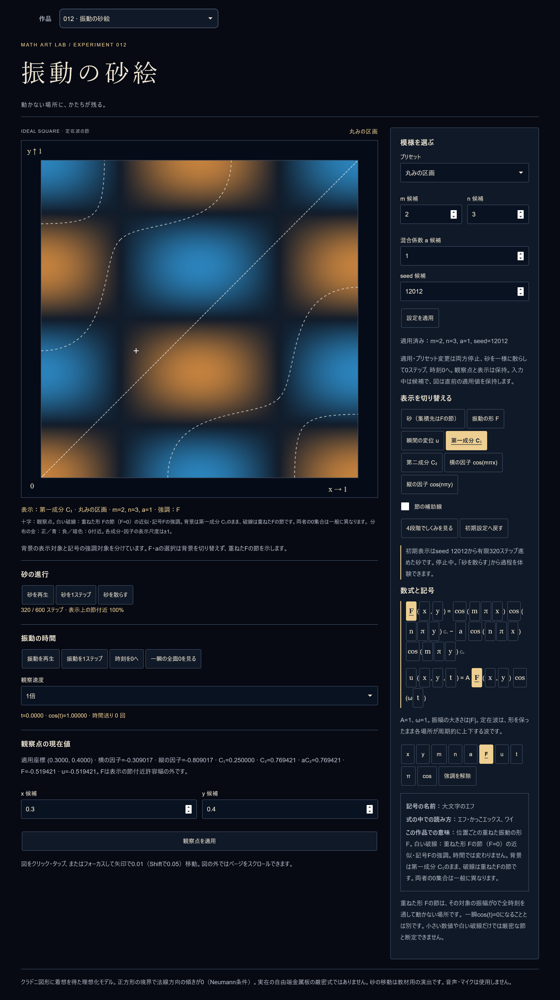
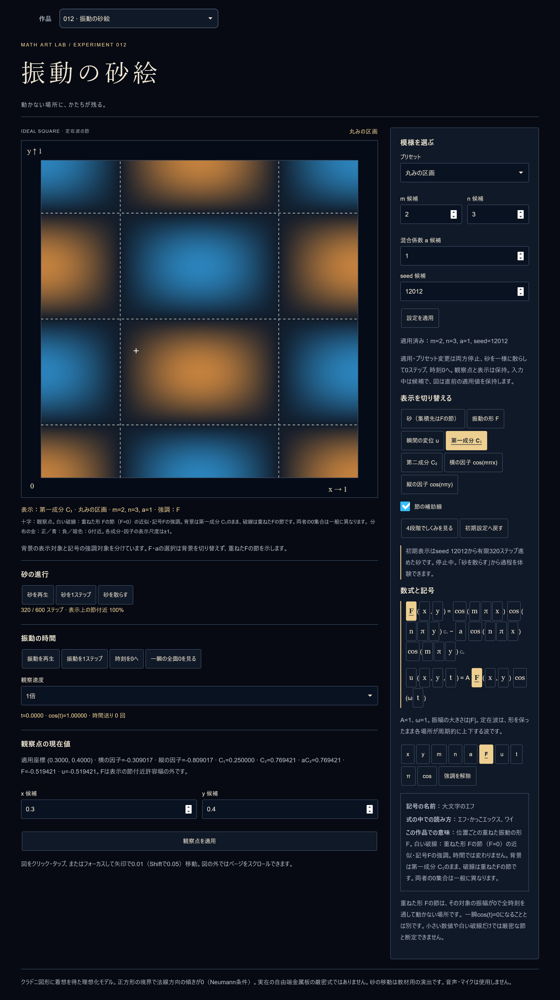

# PR #34 · P2-01：式・説明・節の対象

レビュー対象HEADは`cb99ba58151f7e6d2fd48a52d6788d546fd4f758`。着手時のlocal・PR headはこのSHA、作業ツリーはclean、同じ`feat/012-vibrating-sand`で修正した。リポジトリ内にAGENTS.mdなし、上位AGENTS.mdと会話の回答末尾日時を適用。README・LOG・[初回作品記録](../README.md)・既存実装／検査・PR #34を確認し、Issue #33本文と`request.md`の読戻し一致も確認した。Issue本文は変更しない。

## 根本原因と確認範囲

旧版の説明は選択記号Fを基準に「F=0の節」と表示したが、rendererは**背景の表示モード**で零集合を選んだ。キャッシュ識別も同じモード依存だった。F/aの強調が補助線OFFを上書きして線を出すことだけが共有され、何の式を描くかはUIとrendererで共有されていなかった。第一・第二成分と横・縦因子の全4モードに同じ経路がある。単なるFの分岐漏れ・有限画素誤差ではなく、別の式の0集合を示した不一致。

前回の独立レビューは数値とCanvas命令の独立実行までで、ブラウザGUIの再実行は未実施だった。この範囲を変更しない。**今回の自己検証**で旧HEADをChromium・Playwright WebKitのGUIでも再現し、修正後の画像と対比した。今回の試験追加やGUI成功を独立再レビュー済みとは扱わない。

独立の既知点（m=2,n=3,a=1）：

|点|成分・因子|F|節の判別に使う事実|
|---|---|---:|---|
|(1/4,0)|C₁≈0、C₂=−√2/2|+√2/2|C₁／横因子の0は、Fの0ではない|
|(0,1/4)|C₂≈0、C₁=−√2/2|−√2/2|C₂の0は、Fの0ではない|
|(1/6,0)|C₂≈0、C₁=1/2|1/2|第二成分の縦線とFの節を区別|
|(0,1/6)|横因子=1、縦因子≈0、C₂=1/2|−1/2|縦因子の横線とFの節を区別|
|(1/8,1/8)|C₁=C₂=cos(π/4)cos(3π/8)≠0|0|反対称性からFの対角線が必要|

旧版のCanvas命令は(1/4,0)へ到達（距離0）。修正版のF/a強調では、この点から輪郭までの距離>0.01、対角線上(1/8,1/8)までの距離<10⁻⁸を確認する。同じ命令検査で、普通の補助線に戻した場合には各成分・因子自身の零集合へ到達することも確認。近似輪郭の既知位置許容差は2×10⁻⁵。

## 設計比較と操作契約

1. **F強調時にFの節を表示**：通常画面と教材3・4で採用。背景は成分・因子のまま保ち、白破線だけを重ねたFの節へ切り替える。F式・説明・線が一致し、背景を勝手に全体図へ切り替えない。aもF=C₁−aC₂の係数なので同じFの節と内枠を強調する。
2. **成分・因子自身の節を維持して違いを説明**：強調解除後の通常の補助線で採用。凡例にC₁=0、C₂=0、cos(mπx)=0、cos(nπy)=0をその都度明示する。F選択中までこの零集合を維持すると、Fを選ぶ目的と図が離れるので、その方式は採用しない。
3. **教材前半では未導入のFを制限**：教材1・2で併用。F/a/u/tを無効化（教材1ではy/nも無効）、数式は横因子→第一成分までに限定。全体Fの強調へ飛ばず、描画側にも同じ段階契約を適用する。

|状態|背景|白破線の対象|説明・凡例|
|---|---|---|---|
|通常／教材3・4、Fかaを選択|現在モードを保持|F=0、補助線checkboxより優先|「背景はC₁等のまま、破線は重ねたFの節。0集合は一般に異なる」|
|F/aを解除、補助線ON|保持|表示している成分・因子自身の0。砂／F／uではF=0|対象名と式を明記|
|強調なし、補助線OFF|保持|なし|非表示と、ON時の対象を明記|
|u/tを選択|保持|補助線の契約は上と同じ|輪は重ねたFによるu=F cos(t)。成分・因子背景の変位ではないと明記|
|教材1|横因子だけ|ONならcos(mπx)=0|横因子の式、観察値、断面。F/a/u/t/y/n強調は不可|
|教材2|横因子／縦因子／第一成分だけ|ONなら現在対象自身の0|第一成分までの式・観察値。F/a/u/t強調は不可|
|教材終了／Escape|開始前へ復元|保存したmode・symbol・nodesから再導出|粒子／rng／step／位相／点／表示／強調を復元。既存安全停止を優先|

`sand-presentation.ts`の純粋な`presentation`で有効モード・記号、背景の形、節の対象、凡例、断面線、輪の説明を決める。viewとrendererが同じStateと教材段階を渡す。UI入力の無効化だけに頼らず、イベントとrendererの双方で段階制限を使う。

輪郭キャッシュは適用済みm/n/aと**実際の零集合の対象**（F/first/second/factorX/factorY）を識別子とする。Fを強調したまま背景を変えても同じF輪郭を再利用でき、解除後にC₁等へ戻ると再計算する。設定変更は同じcanvasでもキーが変わる。位相はFの零集合のキーに入れず、uの背景rasterだけ位相で更新。背景のrasterには有効モードを使う。

第二成分はC₂=cos(nπx)cos(mπy)なので、mの強調は縦断面、nは横断面。横因子に含まれないn等を選んだ場合は断面線を追加せず、その理由を説明する。π/cosも現在の因子の方向から断面を導く。強調の判断は粒子・乱数・進行・位相を変更しない。粒子の移動式、seed、境界条件、数式自体は変更していない。

## RED → GREEN と負対照

- [初回命令検査](validation/unit-initial-red.log)：既存含む255件中10失敗・245成功。このうち1件は因子の線形補間位置に10⁻⁸を要求した検査側の精度指定不備（実際のずれ5.23×10⁻⁷）。有限格子の近似に合わせて2×10⁻⁵に校正。
- [校正後の旧版](validation/unit-red.log)：同じ既知点・モード行列で9失敗・246成功。F/aと成分／因子の8組＋報告された反例を検出。F/砂/uと普通の成分補助線は成功し、壊れている範囲を区別した。
- [旧版GUI初回](validation/development-red.log)：両engineで2失敗。F対角線がないことを検出。最初の白判定は細いアンチエイリアス線を拾いきらなかったため、背景の符号色と区別できる明るい無彩色の条件へ校正。
- [校正後の旧版GUI](validation/development-red-calibrated.log)：2失敗。F非ゼロのC₁線近傍に白画素96（Chromium）／94（WebKit）、期待0。Fの対角線も欠落。旧版の[Chromium画像](screenshots/chromium-red-first-F.png)／[WebKit画像](screenshots/webkit-red-first-F.png)を保存。
- [修正後の単体](validation/unit-green.log)：260/260成功。上記と同じ既知点の命令検査に、段階制限・純粋な表示契約の不変性等を追加。
- [最初の修正後GUI](validation/development-initial-green.log)：既存012＋既知反例、開発36/36成功。
- モード全7種×F/a×補助線ON/OFF、解除後の4対象、a=0・m/n入替で同じcanvasのキャッシュを更新、教材1〜4・終了／Escape、強調だけでStateが進まないこと、狭幅200%を追加。拡張した開発／本番の結果は下記へ固定する。

GUIはCanvasの実画素を読み、x=1/4の縦線・x=1/6の縦線・y=1/6の横線があるべきでない領域と、Fの対角線があるべき領域を検査する。border・十字・横因子の断面曲線から離れた領域を使う。期待値を製品の対象選択関数から取り出さず、上の既知点・対称性から決めた。単なる画像hashや線の増加を合格条件にしない。

負対照は実ブラウザの節のPath2Dを、解析的に作った**誤ったC₁の格子**へ差し替える。説明・凡例はFのままにする。同じ画素判定が不一致を拒否し、native strokeへ戻すと再び成功することを両engineで確認する。これは検査中だけの置換で、製品にテスト用の誤描画モードは追加しない。

## 最終結果・画像

実行コマンド：`npm.cmd test`、`npm.cmd run typecheck`、`npm.cmd run build`、`node node_modules/@playwright/test/cli.js test e2e/sand-review.spec.ts e2e/sand.spec.ts`、同production config。既存全作品の回帰は、最終HEADの標準PR CIで実施し、実行HEAD・件数をPRへ追記する。新規skipなし、既存試験の期待値や待機上限を変更しない。

|検証|結果|
|---|---|
|全単体|260/260 PASS（既存236＋今回24）|
|型検査・本番build|PASS、既存chunk警告は保持|
|対象の開発GUI|50/50 PASS、3.2分（既存012の34＋今回16）|
|対象の本番GUI|50/50 PASS、3.0分|
|第二成分m/nの断面方向と不変性の最終追補|開発2/2・本番2/2 PASS、各8.2秒|
|画像|新規32枚（正常30＋誤対象の負対照2）と旧版RED2枚を分離して保存|
|全作品回帰／最終CI|PRの最終HEADで実行し、run URL・HEAD・件数をPR本文／コメントに固定|

最終build：JS778.36KB/gzip226.64KB、CSS38.86KB/gzip7.99KB。新規依存・公開設定・CI timeoutの変更なし。ローカル全件一覧は開発412件・本番292件。今回の追補は対象GUIをローカルで実行し、全作品の回帰は標準CIで確認する。

撮影条件はDPR2、Canvas1000²、両engineでF強調の第一成分背景に対する既知領域の白画素は `(C₁専用, C₂専用, 縦因子専用, F対角線)=(0,0,0,40)`。同じ凡例のまま誤C₁格子へ置換した負対照は `(29,0,56,0)` となり、同じ判定が拒否する。撮影32件すべて要求／描画revision一致・pageerrorなし。値は画素の条件付き観測であり、数学的な節の厳密判定ではない。

|修正後：背景C₁＋Fの節|負対照：説明Fのまま誤C₁格子|
|---|---|
|||

[成分自身の節](screenshots/webkit-green-first-own.png)／[第二成分＋a](screenshots/webkit-green-second-a.png)／[C₂のm縦断面](screenshots/webkit-green-second-m.png)／[教材2](screenshots/webkit-green-lesson-2.png)／[375px light 文字200%](screenshots/webkit-green-375-light-200.png)。

画像再現：開発サーバー4173を起動し`node tools/capture-sand-review.mjs`。[画像マニフェスト](screenshot-manifest.json)に設定・State・表示契約・凡例と説明・要求／描画revision・版・幅・文字サイズ・独立画素判定値とソースhashを保存。負対照も区別して保存する。初回画像／検証記録は上書きせず、今回の追補を初回記録へリンクする。

NOT_TESTEDを保持：実機iPhone Safari、実スクリーンリーダー、実ページズーム、低性能端末等。WindowsのPlaywright WebKit成功を実機Safari成功にしない。今回、WebKit切替遅延の性能再測定や原因解決はしていない。旧HEADの測定値は旧条件の記録で、新HEADの性能保証ではない。

P2-01：修正と対象の自己検証はPASS。独立再レビュー待ち。全体CIの最終結果はPRで対象SHAと照合して固定し、自己検証を独立レビュー完了とは扱わない。総合は実機等の未検証・既存のWebKit遅延を残すPARTIAL、Draft解除・merge・auto-mergeは行わない。

記録：2026-11-05 JST
