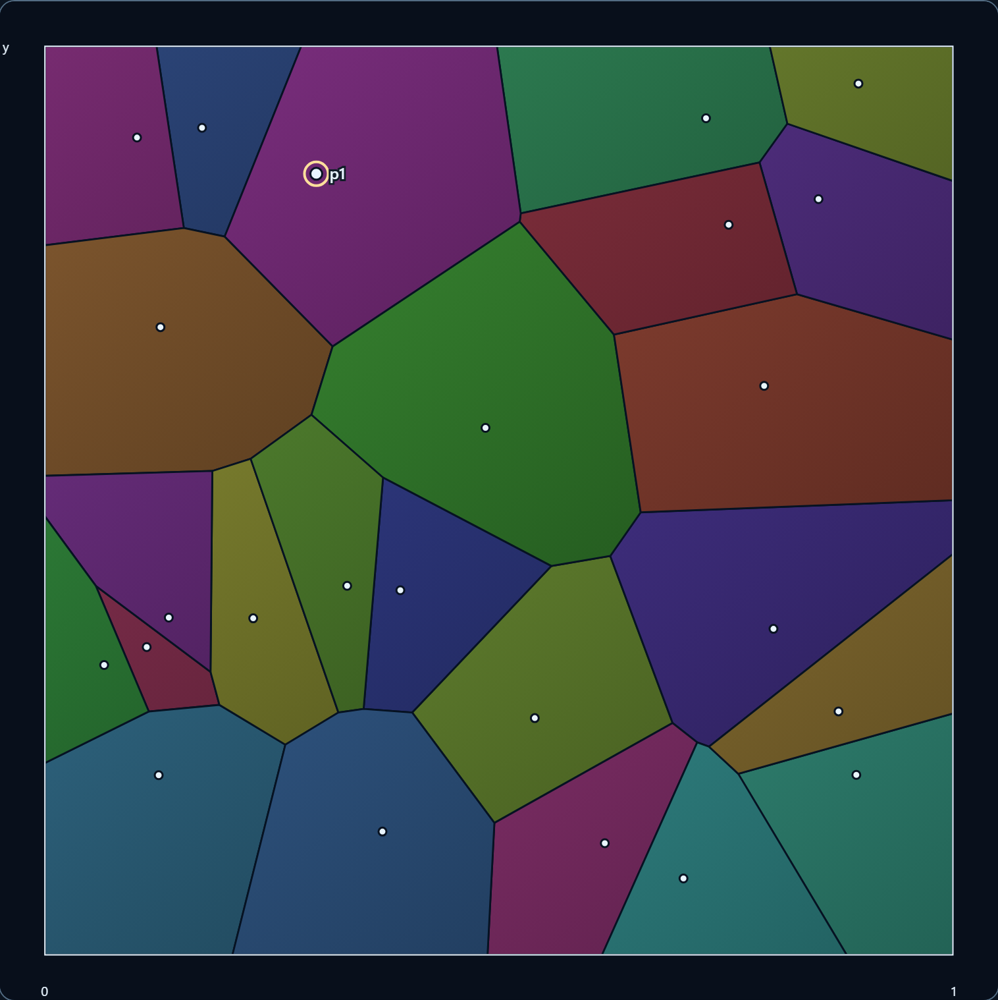
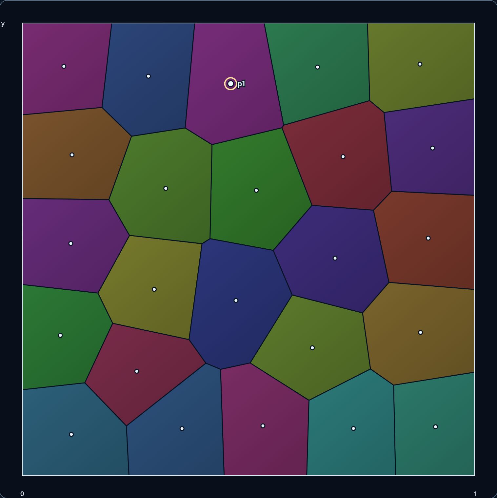

# 011 · 距離の結晶 / Voronoi Crystal

点を動かして距離の比較が境界を決める様子を観察し、ロイド緩和による構造の変化を調べる作品。

2026-11-04追補：[PR #32のP2-01・P3-01修正と独立再レビュー](review-32/README.md)。以下の初回提出時の検証履歴は保存し、現在の観察所属・描画記録の契約は追補を優先する。従来の画像54枚・性能値は初回提出時の証拠で、追補の画像8枚と混同しない。

最初の修正4038c87のCIで幅0からの復帰待ちが2件失敗したため、[サイズ復帰の第2次修正](review-32/size-recovery.md)を実施。RO通知がなくても、待機中のCanvasだけを100msごとに確認して最新状態を描く。0の間はCanvas命令・数学モデル・完了記録を進めず、非表示・破棄で待機を解放する。最新の判定は第2次の最終HEAD／CI対応を参照する。

要求原本：[Issue #31](https://github.com/tetsujisugimori-coder/Math-Art-Lab/issues/31)・[依頼全文](request.md)。Issue本文を初期要求として保持し、具体化と検証履歴はこの記録とPRへ残す。最新origin/main `1c29194eb27872e8930122eae7c4cef0eb537f0b`（PR #29マージ済み）から `feat/011-voronoi-crystal` を作成。開始時は未コミット変更なし、detached HEAD39d32e4。fetch後、専用ブランチで作業。リポジトリ内にAGENTS.md・CONTRIBUTINGはなく、会話で指定された回答末尾の日時を適用する。

上位の `.codex/AGENTS.md` にも「回答の最後に日時を入れるようにしてください。」があり、会話での指定と一致する。既存の10作品、mount/disposeによる切替、数式と図の対応、教材開始前への復元、単体・開発／本番Playwright、Pagesのmain限定公開条件を確認。新作の追加以外で既存作品を変更しない。Issue #30（フーリエ教材のP3）はOPENの別件として保持する。新規ライブラリなし。既存依存のthree.jsは既存作品用であり、この作品はCanvas 2Dと純粋な幾何計算を用いる。

## 数学と数値計算

- 固定領域はΩ=[0,1]×[0,1]。有限長方形の一例として正方形を採用し、比較中の尺度は固定する。内部は右がxの正、上がyの正。距離は通常のユークリッド距離。
- 各領域は `Vᵢ={x∈Ω | ‖x−pᵢ‖≤‖x−pⱼ‖, ∀j}`。数学的には、等距離の境界は複数領域に属し得る。面積0の共有境界は面積和を増やさない。
- 二乗距離の差を展開すると `2(pⱼ−pᵢ)·x≤‖pⱼ‖²−‖pᵢ‖²`。実装は等価な `(pⱼ−pᵢ)/‖pⱼ−pᵢ‖ · (x−(pᵢ+pⱼ)/2)≤0` を使う。二乗した近い値の差を避け、単位法線と中点で近接点の桁落ちを抑える。
- 各点について正方形から開始し、他点の半平面で順にクリップする。内外判定は符号に基づき、許容誤差で領域を膨張させない。交点の係数は `t=dA/(dA−dB)`。競合点は不変IDの昇順で処理し、入力配列の順序に依存しない。
- 面積・重心は、最初の頂点を原点とした符号付き三角形の扇形分割で計算する。`cross=(a−o)×(b−o)`、面積 `|Σcross|/2`、重心 `o+Σ((a−o)+(b−o))cross/(3Σcross)`。面積を重みとし、頂点の単純平均はしない。並進による桁落ちも抑える。
- 全重心を更新前の点集合から算出し、全点を一括更新する。候補点の検証と次の分割の検証まで成功してから状態へ公開する。失敗時は停止し、直前の正常な配置・ステップを保持する。
- 各母点は領域内、IDは正の安全な整数・重複なし。非有限座標・領域外・重複点を拒否する。同一直線上、境界上、角の点は有効。幾何計算の最小点間距離は10⁻⁶で、それより小さい点も明示的に拒否する。
- 座標の許容逸脱は `128×Number.EPSILON≈2.84×10⁻¹⁴`。単位正方形上の演算と最大63回のクリップを考慮した保守的な上限で、実際にその誤差が常に生じるという意味ではない。逸脱がこの範囲内なら0〜1へ丸め、それを超える頂点・重心は拒否する。
- 面積和の許容差は単位面積に対し10⁻¹⁰。最大64領域・多数の交点計算の累積誤差を座標許容値より広く取る。手計算例は10⁻¹²、微小三角形面積は10⁻²¹の絶対許容差で検証する。独立300×300中点標本の積分近似は境界画素の量子化を考慮し0.003とする。
- `|2A|<16×EPSILON²`、頂点3個未満、非有限な面積・重心は更新を拒否する。面積が小さいという理由だけで点を消さない。角に約10⁻⁶間隔で置いた、面積約10⁻¹³の領域を含む試験もある。
- 観察では`mathematicalOwners`と`displayCandidates`を分ける。前者は保持したbinary64座標の厳密な二乗距離比較、後者は丸めた計算距離の最小値との差≤10⁻¹²という表示専用規則。表示上の所属は候補の最小ID。入力前の実数の意図は復元できず、多角形のクリッピングと画素描画は依然として浮動小数点近似である。Canvasでは小さいIDの多角形を最後に描き、共有画素の混色もある。距離線の実線は数学的最近点、金色／茶色は表示候補で、画素色・表示候補を数学的所属と同一視しない。根拠と限界は追補に記録。
- ロイド緩和は有限回の計算。完全な正六角形分割、配置によらない同一形、大域的最適化、有限回での理論的収束は保証しない。

## 構成と操作契約

`voronoi.ts`（数学）→`voronoi-state.ts`（純粋な状態更新）→`voronoi-render.ts`（同じ頂点の描画・座標変換）→`voronoi-view.ts`（DOM・教材・予約管理）。共通インスペクターは改修せず、既存作品と同じ標準button・aria-pressedによる選択方式を使う。CSSは`.crystal`と、011表示中だけ有効な作品pickerの外観に限定。メニューへ011を登録し、他10作品の表示中は追加pickerスタイルも適用しない。

描画幅をs CSS pxとすると、`screenX=s(0.045+0.91x)`、`screenY=s(0.955−0.91y)`。外側4.5%は軸の余白で、ポインター入力はこの逆変換を使う。計算領域は画面サイズに依存しない。CanvasのDPRは2までに制限し、各辺の画素数をround(s×DPR)とする。テーマ・文字拡大・DPR・リサイズは同じ幾何データを再描画し、緩和のステップを進めない。

点・教材・記号の更新は同期的に確定し、Canvasだけを1件のrequestAnimationFrame予約にまとめる。予約は古いStateを捕捉せず、描画時の最新State・領域・比較対象を読む。100回の同期更新でも計算は100ステップ、描画は1回となる。主図・比較図ごとに要求とCanvas命令実行済みのステップ・リビジョンを別記録し、幅0・context喪失・例外では実行済み記録を進めない。画像検証は`drawStatus=submitted`と要求／実行済みリビジョン一致の両方を待つ。これはCPU側のCanvas命令が戻った意味で、GPU表示完了の証明ではない。破棄・非表示で予約を解放し、予約の同一性チェックにより旧callbackが新予約や新作品を壊すことも防ぐ。

|操作|配置・履歴|再生|
|---|---|---|
|初期|不規則24点、初期比較、丸・境界・領域色ON、重心等OFF|停止|
|選択・観察点・記号・表示|点配置とステップを保持|保持|
|座標フォームの入力開始|未適用の入力値を保持し、点はまだ移動しない|停止|
|点の追加・移動・削除|成功した配置を新しい初期配置として保存、0ステップ|停止|
|ドラッグ|直近の有効位置を順次採用。領域外・近すぎる位置は拒否。cancelで直近の有効位置を保持|停止|
|プリセット|基本4点、不規則24点、5×5格子、中央集中24点。固定入力で再現可能|停止|
|1ステップ|直前配置を保存し、全点を重心へ一括更新|停止|
|再生|約700msに1回、1 callbackで1整数ステップ。遅延の追いつき計算をしない|500ステップで停止|
|初期配置に戻す|編集後の初期配置・0ステップへ。表示設定・選択は保持|停止|
|教材の段階変更|段階専用配置へ、0ステップ|停止|
|教材終了・Escape|開始前の全Stateを深いコピーから復元。フォーカスは開始ボタン|元が再生中なら再開。ただし安全停止後は停止|
|非表示・reduced-motion有効化|配置・ステップを保持|停止。復帰しても自動再開しない|
|作品切替・pagehideで破棄|イベント・timer・observer・DPR監視・Canvasを解放|世代を進め、予約済みの旧callbackを拒否|

主要操作は標準フォームとbuttonで実行可能。図にフォーカスし矢印で0.01、Shift併用で0.05移動。追加モードでは観察点を候補にしEnterで追加、Deleteで選択点を削除。図の操作モードを明示し、選択モードの空白クリックで点を勝手に増やさない。母点の選択は22 CSS px以内の最近点を使う。touch-action:noneは操作面だけに指定し、外側は通常のページスクロール。

編集の最小間隔0.025は、320px幅の図の有効幅約269pxで約6.7px。極端に重なる点を作りにくくし、選びにくい点にはselectと座標フォームを併用する。数学用の10⁻⁶とは別のUI制約。1点を維持し、最後の点の削除を拒否する。64点の上限は下記の実測に基づく製品上限で、数学的な制限ではない。

数式の各記号はA.名前、B.式での読み方、C.意味の別フィールドを持つ。∈・∀・≤・ノルム・Ω・バー・添え字に加えVᵢ・cᵢ・更新式も選べる。選択領域・点番号・距離・全境界・外枠・重心と矢印を連動表示し、非表示にした要素でも記号説明に必要な対象は強調する。

「図形を確認」と「選択中の記号へ」で、式と図を明示操作で往復できる。狭幅でも説明と対象を見失わないよう、移動先へフォーカスを渡す。記号選択だけでは自動スクロールしない。ステップや距離の値はaria-live=offとし、状態通知は再生・停止などの変化時だけ更新する。

教材は①2点と距離、②4点と空間分割、③選択領域の面積重心と1ステップ、④繰り返しと初期比較。①は観察モード固定、①〜③は点の追加・削除・プリセット変更を制限し、段階の前提を維持する。②③は母点移動・選択が可能。④は汎用説明のままプリセットを変更できる。保存対象には配置だけでなく初期・直前・ステップ・選択・観察点・モード・記号・全レイヤー・比較対象・再生状態も含む。

## 自己検証の方法と履歴

実行コマンド：`npm ci`、`npm test`、`npm run typecheck`、`npm run build`、`npm run test:e2e`、`npm run test:e2e:production`。新作の共有試験は`e2e/voronoi-checks.ts`から開発・本番の双方へ読み込む。既存試験の期待値・個別の待機時間上限・skipは変更しない。

保存した端末ログは可読性のためANSI制御列と行末空白だけを除去した。試験名・警告・失敗・数値・結果の内容は保持し、測定JSONは数値をそのまま保存する。

CIジョブ全体の実行予算は20分→30分へ具体化した。直前mainの[run 41511807633](https://github.com/tetsujisugimori-coder/Math-Art-Lab/actions/runs/41511807633)はValidateに18分58秒（開発12分59秒、本番4分9秒）を要していた。新作30件×開発／本番が加わり、新作28件だけでもローカル1分48秒であるため、20分の予算では不足する見込みと分かった。失敗した試験の待機時間を延ばす変更ではなく、全試験を保ったまま増えた件数の実行時間を確保する。OS・依存・個別試験・公開条件・deployジョブ・権限は変更しない。最終CIで実績も確認する。

|観点|独立した期待値・確認経路|
|---|---|
|1点／2点／対角／3点同一直線／4隅|面積1、1/2、三角形重心1/3・2/3、幅3/8・1/4・3/8、四分割1/4を手計算で照合|
|面積重心|台形の面積6・重心(14/9,8/9)、微小三角形、逆順頂点、退化拒否|
|一般配置|全頂点・重心の独立した二乗距離不等式、全領域面積和、300×300の別方式積分近似|
|不正値・近接・境界|重複・近すぎる点・範囲外・非有限・ID重複・最大超過・最後の点削除を拒否。正常配置を保持|
|同時更新・決定性|非対称2点の解析値(.15,.5),(.65,.5)、入力順序反転、格子の不動性、100回更新|
|GUIと数学の一致|2点分割の面積と境界画素・領域画素、実座標のポインター入力、教材前後のStateとPNG一致|
|アクセシビリティと配置|両ブラウザ、4幅、両テーマ、文字100/200%、Tabフォーカス、キーボード、タッチ相当、図外スクロール。実コンテキストのDPR1/2に加え、1.5への変更とresolutionイベントを模擬し、同じStateのまま画素寸法が変わることを確認|
|ライフサイクル|停止・reset・教材・作品切替後に旧timerを強制呼出ししても無作用、非表示・reduced-motion後の自動再開抑止|

初回失敗を保持する：

1. Vite/esbuildはサンドボックス内の親ディレクトリ解決でAccess deniedとなりビルド未到達。製品のbuild失敗と区別し、承認された通常権限で同じbuildを実行して成功。
2. 単体初回183件中182成功・1失敗。画面変換のy=4.499999999999993を4.5と厳密比較した試験側の誤り。100px尺度で約7×10⁻¹⁵の丸め差と確認し、13桁の近似比較へ修正。再実行183/183成功。
3. 新作GUI初回28件中14成功・14失敗。両ブラウザで同じ7件ずつ。距離一覧とcheckboxのID重複による製品不具合（教材・画素試験の計4失敗）を別ID化。記号の直前選択との画像比較は同じ対象を強調する場合があるため、解除状態との比較へ試験を修正（2失敗）。通常表示との差が弱い添え字・距離・重心の強調も製品側で改善。残る8失敗はマウス操作後にprogrammatic focusしてfocus-visibleを期待した試験の誤り。Tab／Shift+Tab経路へ修正し、Canvasの枠が親のoverflowで切れないようoutlineを内側へ配置した。
4. 全体回帰と並行したソース点検で、右上の母点ラベルが狭いCanvasから切れる問題を発見。追加した描画命令試験で、幅264pxに対しラベル右端276.12pxとなることを再現した（184件中183成功・新規1失敗）。数学的な位置は正しく、文字配置の製品不具合として修正対象にした。
5. 再生中の座標フォームを別コンテキストで調べ、入力x=0.12・y=0.24が、タイマー更新後にx=0.23402761746426337・y=0.24として適用される製品不具合を再現。座標入力の最初のinputイベントで停止し、兄弟フィールドへの移動で未適用値が上書きされないよう修正した。GUIに再生→入力→待機→移動の経路を追加。再現ハーネス初回は全体試験終了で既存サーバーも停止しており、接続拒否で製品へ未到達。専用サーバーを起動した再実行で上記の反例を確認した。
6. 目視でライトテーマの記号説明が薄いことを発見。既存のグローバルdd色#c1cee1を継承し、白背景とのコントラストが約1.59だった。新作内で本文色#183647を継承するよう明示し、約12.67へ改善。4幅×両テーマ×文字100/200%で比4.5以上を検査する。既存のaside高さ制限も新作内で解除し、図外のページスクロールを保つ。CSS修正後の対象GUIは開発8/8・本番8/8成功。
7. 64点・全補助表示を100回、同じJavaScript処理内で同期描画するストレス条件で、1操作最大2255.2ms／259ms（Chromium／WebKit）を観測。画面更新を挟む同条件では最大25.3ms／80msとなり、描画の蓄積に依存する停止と切り分けた。ブラウザ内部の正確な要因はプロファイラーで確定していない。数理計算を保ち、描画だけを1件にまとめる修正を採用。修正前の[同期ストレス生データ](measurements-before-coalescing.json)・[paced初回](measurements-paced-initial.json)・[paced再測定](measurements-paced-before-coalescing.json)を保持し、改善後の値で上書きしない。
8. 往復ボタン上でEscapeを押して強調を解除すると、そのボタンが非表示になるため、Canvasへフォーカスを戻す処理と試験を追加。最初の対象試験は開発・本番ともChromiumがbeforeEachのpage.goto(load)で30秒待機に失敗し、作品011の選択に未到達。各WebKitは成功した（各1成功・1失敗）。正確な原因は未確定。該当[開発ログ](validation/development-focus-initial-failure.log)・[本番ログ](validation/production-focus-initial-failure.log)を保持する。待機上限・コード・試験を変えず、他のブラウザ作業と分けた再試行は開発2/2成功（32.3秒）・本番2/2成功（30.9秒）。[開発再試行](validation/development-focus-retry.log)・[本番再試行](validation/production-focus-retry.log)。再試行成功を原因解決とは扱わず、独立レビューへ引き継ぐ。
9. WebKitのデスクトップ画像で、ネイティブselectが白背景と淡色文字になり読めないことを発見。新作のselectと、011表示中の作品pickerだけappearance:noneでCSS描画に統一し、テーマごとの文字・背景・矢印・option色を指定した。ネイティブフォームの見え方は計算済みCSS色だけでは検証できないため、appearanceの検査と実画像の再確認を加えた。既存10作品表示中のpickerには適用せず、共通スタイルファイルも変更しない。

最終フォーム外観とキーボード・フォーカス・全4幅／テーマ／文字拡大の対象確認は、開発10/10・本番10/10成功（各1.3分）。[開発](validation/development-select-final.log)・[本番](validation/production-select-final.log)。最終成果物を再撮影し、WebKitのselected文字も判読可能であることを確認した。

10. 描画を非同期化した後の撮影で、WebKitの全ページ画像に切替前のCanvasが残り、現在値と図の対象が違う撮影手順の不備を発見。各画像で2回の画面更新と描画リビジョンの一致を待つよう撮影スクリプトを修正し、54枚を撮り直した。[画像マニフェスト](screenshot-manifest.json)に点配置・設定・ステップ・モデル／描画リビジョン・テーマ・文字サイズ・DPRの画素寸法を保存。全54件のリビジョン一致と、代表画像のp1位置・現在値・フォームの文字を照合した。製品の数学モデルや試験期待値は変更しない。

11. 初回提出HEAD6cdf5d2のCI待機中の画像点検で、ライトテーマのbackground短縮指定が選択欄の矢印画像を消すCSS競合を確認。background-colorへ限定し、全選択欄のbackground-imageがnoneにならないことを追加検査。追補の対象試験は開発8/8（58.2秒）・本番8/8（53.6秒）成功。[開発](validation/development-arrows-final.log)・[本番](validation/production-arrows-final.log)。数理・状態・描画方式は変更せず、追補HEADのCIを最終として照合する。

全体回帰は、上記4・5の最終調整前に開発338成功＋既存の手動撮影2skip（340件、30.3分）、本番220/220成功（10.7分）。開発のChromium終了後、本番を別ポート・別出力先で併行実行した。数学モデル・既存作品・共通UIはその後変更せず、新作内のラベル・フォーム・往復ナビゲーション・状態通知だけを調整した。最終調整後の単体は184/184成功（既存157＋新作27）、型検査・build成功。最終の新作GUIとCIを別に照合する。全体回帰の[開発ログ](validation/development-full.log)・[本番ログ](validation/production-full.log)を保持する。

最終修正後の新作GUIは開発30/30成功（2.1分）・本番30/30成功（2.0分）。両ブラウザで境界座標(1,1)の移動、再生中の座標入力保持、式と図の往復フォーカス、教材第4段階のプリセット変更も通過した。[開発の最終ログ](validation/development-crystal-final.log)・[本番の最終ログ](validation/production-crystal-final.log)を保持する。最終HEADとCIの実行コミット・結論はDraft PRの最終検証コメントへ固定して記録する。

その後の描画統合・コントラスト修正を含む新作GUIも開発30/30・本番30/30成功（各1.8分）。10ステップの同期更新で途中の描画が増えず、最終図がステップ10に対応すること、古いtimerと描画callbackの強制実行が新しい作品を壊さないことも確認。[描画統合後の開発ログ](validation/development-coalesced-final.log)・[本番ログ](validation/production-coalesced-final.log)。個別試験の上限延長や新規skipはない。DPR変更と画素試験は予約描画の完了を待つよう変更した。これは非同期描画を採用したための試験同期であり、失敗を長い待機で隠す変更ではない。

## 画像・性能・限界

再現用スクリプト：`node tools/capture-voronoi.mjs`。ブラウザ版・CPU・Node・描画サイズ・DPR・全サンプル・最大値を[生データ](measurements.json)へ保存する。測定はCPU上の計算・DOM更新・Canvas命令投入時間で、GPU合成完了・実端末のフレームレート保証ではない。

Windows / Intel Core i7-14650HX / Node24.20.0 / Chromium145.0.7632.6・WebKit26.0、1280×1000、DPR2（主Canvas1516×1516画素）。試験・撮影を並行させず性能を測定した。WebKitの0msは時計分解能未満を含み、計算時間0の証明ではない。

|描画統合後・64点|Chromium|WebKit|
|---|---:|---:|
|純粋モデル：緩和＋次の分割、150回中の最大|2.1ms|3ms|
|全表示・同期100更新：1操作CPU最大|2ms|6ms|
|同100更新：CPU合計|153.3ms|233ms|
|同100更新：最終Canvas描画（1回）|1.5ms|2ms|
|同100更新：2画面更新を待つまでの全時間|171.6ms|271ms|

同100更新の計算ステップと描画済みステップはいずれも100、描画回数は両ブラウザとも1。旧2255.2msを隠さず、条件と方式の違いを分けて示す。これは最大観測値で、任意の端末・配置・ブラウザ状態の上限保証ではない。実再生20ステップ・画面更新を挟む60ステップ・20回ドラッグの[最終測定](measurements-paced.json)も別に保持する（`node tools/measure-voronoi-paced.mjs`）。

最終paced測定は他の試験・撮影の終了後に単独実行し、document.visibleとCanvasの表示位置も記録した。最終フォーカス試験と起動が一部重なった[先行測定](measurements-paced-visible-overlap.json)、表示位置を明示する前の[測定](measurements-paced-coalesced-offscreen.json)も区別して保持する。

|最終paced・64点・全補助表示の最大観測値|Chromium|WebKit|
|---|---:|---:|
|60回の1ステップ：CPU処理|20.7ms|29ms|
|同：2回のrAFを待つまでの経過時間|148.9ms|372ms|
|20ステップ実再生：Canvas命令投入|8.6ms|19ms|
|同：描画観察の間隔|731.9ms|761ms|
|停止ボタン：CPU処理|2.2ms|3ms|
|同：2回のrAFを待つまでの経過時間|114.5ms|504ms|
|20回ドラッグ：イベント処理|21.8ms|25ms|

2回のrAF待機はブラウザのフレーム供給・OSのスケジューリングを含み、CPU処理時間でもGPU合成完了の保証でもない。WebKitで最大504ms待機した事実を保持し、滑らかさを保証しない。初回の同種条件には80msのCPU操作、566msの2rAF待機もあり、[全測定履歴](./)を参照。低性能端末・実機Safariの性能はNOT_TESTED。64点の製品上限は、この環境の実再生と入力のCPU処理が数十ms内であったこと、および狭幅での選択・座標フォームの操作性を根拠に採用した。

|初期の不規則24点|同じ初期配置から20ステップ|
|---|---|
|||

[デスクトップ全体](screenshots/chromium-desktop-dark.png)／[375px・ライト・文字200%の教材](screenshots/chromium-mobile-lesson-light-200.png)／[記号の3分類](screenshots/chromium-mobile-inspector-light-200.png)／[内側に描くフォーカス枠](screenshots/chromium-focus-light-200.png)。[全スクリーンショット](screenshots/)には両ブラウザ・4幅・両テーマ・文字100/200%と4プリセットを保存する。

ビルド基準は同じNode24.20.0・lockfileの依存を用いた最新mainのアーカイブ。mainのJS715.77KB/gzip204.70KB、CSS29.65KB/gzip6.30KB。最終実装はJS745.81KB/gzip214.37KB、CSS33.86KB/gzip7.09KB。JS約4.20%増、gzip約4.72%増で、新規依存なし。500KB超のchunk警告はmainにも存在し、警告抑制の設定変更はしていない。

NOT_TESTED：実機iPhone Safari、実スクリーンリーダーでの読み上げ、低性能端末、OS拡大・実ページズーム200%、電池・熱・長時間運用。文字200%はルートfont-size変更。WindowsのPlaywright WebKitは実機Safariではない。独立レビューは別判定であり、この自己検証を独立レビュー済みとは扱わない。新作を含む本番Pagesへの公開はマージ後となるため未実施。既存Pagesの設定とローカル本番成果物は別に確認する。

自己検証：機能・数学・実施した自動試験の範囲はPASS。総合はPARTIAL（実機等のNOT_TESTED、初回読み込み失敗の原因未確定、画面更新待機の制約）。独立レビュー：未実施。独立レビュー待ちで、マージ・auto-mergeを行わない。

記録：2026-11-03 JST
